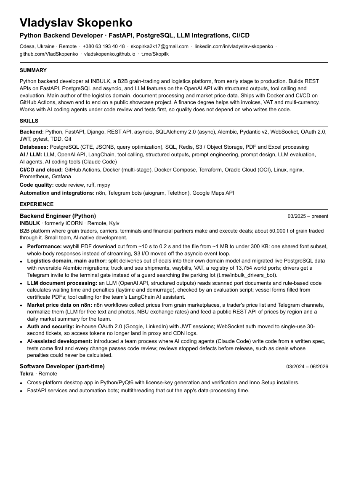

# 📄 Resume Generator

A simple Python script that renders single-column, ATS-friendly resumes to HTML and PDF. One data file per language, easy to customize.


## 📸 Preview



## ✨ Features

- 🎨 Clean single-column layout that ATS parsers read in order: standard section names, no tables or sidebars
- 📱 A4 paper size, print-ready, flows onto a second page when needed
- 🔗 Links print as readable addresses, so they survive paper and ATS text extraction
- 📝 Multiple sections: Summary, Experience, Education, Skills, Languages, Certifications, Projects
- 🖨️ Easy PDF export via browser print function
- ⚡ No dependencies required (pure Python)

## 🚀 Quick Start

### 1. Clone or download the repository

```bash
git clone https://github.com/VladSkopenko/resume-generator.git
cd resume-generator
```

### 2. Edit your data

The resume lives in `variants/en.py` as a `RESUME_DATA` dictionary, with shared parts (contacts, jobs,
education, certifications) in `variants/_common.py`; files starting with `_` are not built. `headlines` maps a file
suffix to a title: the generator writes one resume per headline with the same content, so each vacancy gets the
title it asks for.

Supported keys: `lang` (`en` or `uk`, sets section titles), `file_name`, `name`, `title` or `headlines`, `contact`
(`location`, `phone`, `email`, `linkedin`, `github`, `website`, `telegram`), `summary`, `skills`
(a list, or a dict of groups), `experience`, `extra_experience` (one-line entries), `projects`
(`name`, `period`, `stack`, `description`, `bullets`, `links` as `{"text", "url"}`), `education`,
`certifications` (plain strings or `{"name", "issuer", "date", "id", "link"}`),
`languages`, `talks` (dicts or plain strings). Sections render in that order, one column.

### 3. Generate your resume

```bash
python resume_generator.py               # build every resume into output/
python resume_generator.py en            # build one data file (all its headlines)
python resume_generator.py --pdf         # also export PDFs with headless Google Chrome
```

### 4. Export to PDF

With `--pdf` the script prints every resume to an A4 PDF next to its HTML. Without Chrome,
open the HTML, press `Cmd+P` (Mac) or `Ctrl+P` (Windows/Linux) and choose **Save as PDF**.

### 5. Run the tests

```bash
python -m unittest test_resume_generator
```

## 🎨 Customization

The layout is black and white only: no accent colors, gray text or tinted rules, so the resume
prints cleanly and reads as a plain document. `STYLE_CONFIG` keeps the values in one place and a
test fails if any other color appears in the output:

```python
STYLE_CONFIG = {
    "accent_color": "#000000",      # Headings and links
    "text_color": "#000000",        # Main text
    "light_text": "#000000",        # Dates, locations, contacts
    "rule_color": "#000000",        # Section dividers
    "background": "#ffffff",        # Page background
    "font_family": "Arial, 'Helvetica Neue', Helvetica, sans-serif",
}
```

## 📁 Project Structure

```
resume-generator/
├── resume_generator.py        # Template, rendering and CLI
├── test_resume_generator.py   # Tests (python -m unittest)
├── variants/
│   ├── _common.py             # Shared data: contacts, jobs, education, certifications
│   └── en.py                  # The resume: content and headlines
├── output/                    # Generated HTML and PDF files
└── README.md
```

## 🤝 Contributing

Feel free to fork this project and customize it for your needs!

## 📝 License

MIT License - feel free to use this for your own resume!

---

Made with ❤️ by [Vladyslav Skopenko](https://github.com/VladSkopenko)

